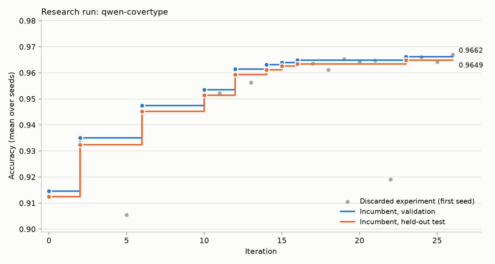

# automl-research-harness

An LLM acts as the ML researcher; this harness is the lab it works in. Given a
dataset with a locked validation and test split, the model inspects the data,
writes a hypothesis and a complete training script, and the harness runs it on
the local GPU, scores it, and feeds the result back. Regressions are discarded,
crashes are sent back to be repaired, and the loop continues unattended until
it converges.

The interesting part of a system like this is not getting a model to emit
PyTorch. It is making the loop's conclusions trustworthy when nobody is
watching. That is what most of the code is for.

## A real run

Forest Covertype (581k rows, 54 features, 7 classes), 60 seconds of training per
run on a laptop RTX 5090, with a local 27B open-weights model
(`qwen/qwen3.8-27b` served by LM Studio) as the researcher. Full artefacts are in
[`runs/qwen-covertype`](runs/qwen-covertype): the journal, every file the model
wrote, and the generated [report](runs/qwen-covertype/report.md).



| | Validation accuracy | Test accuracy (hidden during the run) |
|---|---|---|
| Seed solution (plain MLP) | 0.9145 ± 0.0048 | 0.9125 ± 0.0056 |
| Final incumbent after 26 iterations | 0.9662 ± 0.0001 | 0.9649 ± 0.0001 |
| Gain | +0.0517 | +0.0524 |
| Reference: logistic regression | 0.7269 | 0.7227 |
| Reference: hand-configured LightGBM | 0.9709 ± 0.0004 | 0.9702 ± 0.0002 |

What happened, read straight from the journal:

- **20 experiments ran: 8 accepted, 12 discarded.** Ten were dropped after one
  seed and two more passed the first seed but were rejected on confirmation
  because the gain was inside the seed noise (iterations 19 and 26). Without the
  confirmation step both would have become the incumbent.
- **The gain is real.** The test split the researcher never saw moved by
  +0.0524 against +0.0517 on validation, so 26 rounds of selecting on
  validation did not overfit it.
- **The first accepted experiment crashed twice before it ran.** The model's
  switch from the MLP to gradient boosting raised an exception, then tripped
  the static check; both errors were fed back and the third version was scored
  and accepted.
- **It did not beat the reference.** The researcher cut the error rate from 8.6%
  to 3.4% but stopped short of a hand-configured LightGBM at 2.9%. Its strategy
  was sound and narrow: it abandoned the MLP at once, then climbed tree capacity
  and regularisation one parameter at a time. It tried a neural model once more
  (iteration 22, 0.919) and never ran a data probe or proposed a new
  architecture. That is a property of this researcher model, and the reason the
  backend is pluggable.
- **One harness bug surfaced and is visible in the log.** Six of the first nine
  iterations are empty: the local model spent its whole output budget on hidden
  reasoning and returned no code. The loop skipped them and stopped itself after
  three in a row. The fix (cap reasoning effort, detect truncation) is in
  `harness/llm.py`, and the same run directory was then resumed from its
  journal, which is why the iteration numbers continue from 10.

The seed solution scores slightly differently in the two tables (0.9145 in the
run, 0.9081 in the reference table). Training is cut off by wall-clock time, so
the same seed does not complete the same number of steps twice.

## How the loop works

```
            ┌────────────────────────── journal.jsonl (append-only state) ◄────────┐
            ▼                                                                      │
   researcher model ──► hypothesis + full training file                            │
            ▲                    │                                                 │
            │             static check (import allowlist, no file/process/net)     │
   error + traceback             │                                                 │
   (up to 2 repairs)             ▼                                                 │
            └──── crash ◄── subprocess: fit(X_train, y_train) -> predict           │
                                 │   scrubbed env, hard timeout, process-tree kill │
                                 ▼                                                 │
                    parent scores predictions on validation                        │
                                 │                                                 │
                 seed 0 beats incumbent mean? ── no ──► discard ──────────────────►┤
                                 │ yes                                             │
                         run remaining seeds                                       │
                                 │                                                 │
              mean gain > max(min_delta, seed noise)? ── no ──► discard ──────────►┤
                                 │ yes                                             │
                          new incumbent ──────────────────────────────────────────►┘
```

Each turn the model sees the incumbent's code, a one-line-per-experiment log of
everything tried so far, the loss curve and output of its last experiment, and
any data probes it ran. It replies with a hypothesis, a category
(architecture, loss, features, optimization, regularization, ablation, hparam)
and one Python file. The run ends after `--patience` experiments without an
accepted gain, at `--max-iters`, at `--max-hours`, or when the model itself
says it is done.

## What keeps the results honest

- **The candidate never sees held-out data.** Generated code receives only the
  training arrays and returns a `predict` function. A trusted runner applies it
  to the validation and test features, and the parent process does the scoring.
  Labels for both splits live in a directory that is never passed to the child.
- **The researcher never sees test scores.** Every run is also scored on a test
  split, stored under a `hidden` key in the journal, and read only by the report
  generator. The report then shows validation and test side by side, so
  overfitting to the validation split through many rounds of selection is
  visible instead of assumed away. A test in the suite checks that no test
  score ever appears in a prompt.
- **One lucky seed is not an improvement.** A candidate is screened on one
  seed. If it beats the incumbent's mean it is re-run on two more, and it is
  accepted only when the mean gain exceeds both a floor and the standard error
  of the difference between the two sets of seeds. Three seeds make this a
  coarse filter, not a significance test; it exists to stop the incumbent
  ratcheting upward on noise.
- **Reference models go through the same runner.** Logistic regression and
  LightGBM are scored on the same splits with the same code path, so the final
  number has something to be compared against. The reference is configured to
  be a fair one: LightGBM's default `min_sum_hessian_in_leaf` makes the
  multiclass loss diverge on this dataset (0.58 accuracy), so it is raised.

## What keeps it running for hours

- **The journal is the only state.** Every outcome is appended and fsynced to
  `journal.jsonl`. Kill the process at any point and `run` with the same
  `--run-dir` resumes from the last completed iteration.
- **Crashes are repaired, not fatal.** A static-check failure, exception,
  timeout or malformed prediction array is returned to the model with the
  traceback, up to two times per experiment. What still fails is logged as a
  failed experiment and the loop moves on.
- **Runs cannot hang.** Each training run gets a wall-clock budget and is
  killed with its whole process tree if it overshoots the budget plus a grace
  period.
- **Model outages are survivable.** Transient backend errors are retried with
  exponential backoff; a fatal one (bad key, server gone) stops the run cleanly
  with state intact. Unusable replies and unexpected harness errors skip the
  iteration rather than end the run.

## Running it

```bash
python -m venv .venv && . .venv/bin/activate
pip install torch --index-url https://download.pytorch.org/whl/cu128   # or the CPU build
pip install -e ".[dev]"

python -m harness prepare                # download Covertype, write the fixed splits
python -m harness baselines              # score the reference models
```

With a local model served by LM Studio (or any OpenAI-compatible server):

```bash
python -m harness run --run-dir runs/qwen --backend lmstudio --model qwen/qwen3.8-27b
```

With Claude (reads `ANTHROPIC_API_KEY` from the environment):

```bash
python -m harness run --run-dir runs/claude --backend anthropic
```

Useful flags: `--max-iters 30`, `--patience 8`, `--budget 60` (training seconds
per run), `--max-hours 8`. `python -m harness report --run-dir runs/qwen`
rebuilds the report at any time, including while a run is in progress.

A run directory contains `journal.jsonl`, every file the model wrote under
`candidates/`, and `report.md` with `progress.png`.

### Bringing your own dataset

Call `harness.data.write_dataset(out_dir, X, y, name=..., feature_names=...,
description=...)` with a feature matrix and integer class labels. It writes the
stratified splits in the layout the harness expects; pass the directory as
`--data-dir`. The task is multiclass classification scored by accuracy.

## Layout

| Path | Role |
|---|---|
| `harness/agent.py` | The research loop and the accept/discard flow |
| `harness/sandbox.py` | Static check, subprocess execution, timeout, output validation |
| `harness/runner.py` | Trusted entry point inside the child process |
| `harness/scoring.py` | Held-out scoring and the acceptance rule |
| `harness/journal.py` | Append-only state and replay |
| `harness/prompts.py` | Researcher prompt and reply parsing |
| `harness/llm.py` | Backends: OpenAI-compatible local server, Claude API |
| `harness/report.py` | Report and chart; the only reader of test scores |
| `baselines/` | Seed solution and reference models |
| `tests/` | Unit tests and a full loop driven by a scripted model |

## Limits

- The sandbox is a guardrail against sloppy generated code, not a security
  boundary. The static check blocks the obvious routes to the file system,
  processes and network, but the child runs as the same user. Against code you
  do not trust, run the child in a container.
- The test split is hidden from the researcher but it is still one split.
  Report numbers are point estimates over three seeds.
- Experiments are compared at a fixed wall-clock budget on one machine, so
  results depend on the hardware and on whatever else the GPU is doing.
- One task type so far: multiclass classification on tabular features.

## Tests

```bash
pytest
```

The end-to-end test drives the real loop with a scripted model on a small
synthetic dataset: a probe, a transient backend error, a crashing experiment
that gets repaired and accepted, a regression that gets discarded, an unusable
reply, then stop and resume.
