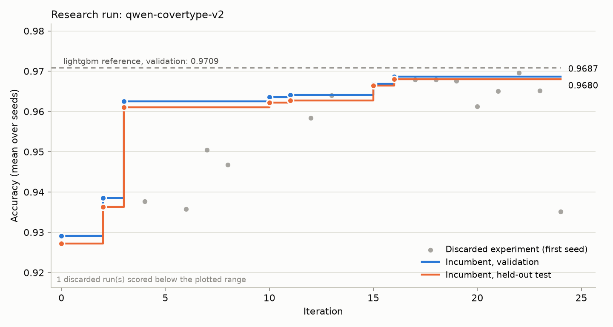

# Run report: qwen-covertype-v2

Stopped: converged: 8 experiments without an accepted gain

## Headline

| | Validation accuracy | Test accuracy (hidden during the run) |
|---|---|---|
| Seed solution | 0.9292 ± 0.0036 | 0.9272 ± 0.0028 |
| Final incumbent (iteration 16) | 0.9687 ± 0.0005 | 0.9680 ± 0.0003 |
| Gain | +0.0395 | +0.0408 |

Mean ± standard deviation over seeds. The researcher model only ever saw the validation column; the test column measures how much of the gain is real.

## Reference models (same splits, same runner)

| Model | Validation | Test | Fit time |
|---|---|---|---|
| lightgbm_ref | 0.9709 ± 0.0004 | 0.9702 ± 0.0002 | 62s |
| logreg | 0.7269 ± 0.0000 | 0.7227 ± 0.0000 | 41s |
| seed_mlp | 0.9081 ± 0.0010 | 0.9060 ± 0.0014 | 60s |

## Activity

- Experiments: 21 (6 accepted, 14 discarded on the first seed, 1 discarded as within seed noise, 0 failed to run)
- Crashes repaired by the model and then scored: 2
- Data probes: 1
- Model tokens in the final session: 197,802 in, 118,310 out

## Accepted steps

| Iter | Kind | Validation | Test | Hypothesis |
|---|---|---|---|---|
| 0 | baseline | 0.9292 | 0.9272 | Starting point supplied with the harness. |
| 2 | features | 0.9385 | 0.9362 | Adding explicit elevation × category interaction features (elevation × wilderness area, elevation × top soil types, elevation²) will help the MLP capture the hierarchical splitting structure that trees exploit, closing the gap to LightGBM. |
| 3 | architecture | 0.9625 | 0.9610 | Widening the model to 768-768-384 with dropout 0.1 and reducing batch size to 1024 (for more gradient updates) will improve validation accuracy by better capturing the subtle class 0 vs class 1 distinction while regularizing against overfitting. |
| 10 | architecture | 0.9636 | 0.9622 | Replacing the 3-layer 768-768-384 MLP with a 4-layer residual network (512-wide with skip connections and GELU) will improve validation accuracy by enabling deeper feature interactions to be learned more effectively, particularly for the subtle class 0/1 boundary that requires composing multiple feature relationships. |
| 11 | optimization | 0.9641 | 0.9627 | Reducing the peak learning rate from 5e-3 to 2e-3 will reduce the oscillation visible in the training curve (holdout dropping from 0.9496→0.9217 and 0.9727→0.9509) and allow the model to converge to a better minimum, improving validation accuracy. |
| 15 | optimization | 0.9668 | 0.9665 | Fixing the learning rate schedule (which currently oscillates after step 3000 due to the cosine going past π) will eliminate the erratic LR behavior seen in the training curve (holdout dropping 0.9732→0.9552) and allow smoother convergence to a better minimum, improving validation accuracy. |
| 16 | architecture | 0.9687 | 0.9680 | Widening the residual network from 512 to 768 hidden dimensions will improve validation accuracy by providing more capacity to learn the higher-order interactions (elevation × soil × wilderness) needed to separate the closely-spaced classes 0/1 and 2/5, building on the fact that the 768-wide model in iter 3 was the best non-residual architecture. |

## Every experiment

| Iter | Kind | Outcome | Val (first seed) | Repairs | Hypothesis |
|---|---|---|---|---|---|
| 2 | features | accepted | 0.9390 | 0 | Adding explicit elevation × category interaction features (elevation × wilderness area, elevation × top soil types, elevation²) will help the MLP capture the hierarchical splitting structure that trees exploit, closing the gap to LightGBM. |
| 3 | architecture | accepted | 0.9618 | 1 | Widening the model to 768-768-384 with dropout 0.1 and reducing batch size to 1024 (for more gradient updates) will improve validation accuracy by better capturing the subtle class 0 vs class 1 distinction while regularizing against overfitting. |
| 4 | regularization | rejected_screen | 0.9377 | 0 | Adding Mixup augmentation (alpha=0.2) and label smoothing (0.1) will reduce overfitting on the class 0/1 boundary and improve validation accuracy by ~0.005-0.01, closing part of the gap to LightGBM. |
| 5 | optimization | rejected_screen | 0.9121 | 0 | Switching from AdamW (lr=5e-3, batch=1024) to SGD+momentum (lr=1.0, batch=4096) will improve validation accuracy because larger batches give more stable gradient estimates and momentum-based SGD finds flatter minima that generalize better on tabular data with BatchNorm. |
| 6 | optimization | rejected_screen | 0.9358 | 0 | Reducing batch size from 1024 to 512 will double the number of gradient updates within the same time budget, allowing the model to better converge on the subtle class 0/1 and 2/5 boundaries that are currently underfit (training loss still ~0.2 at end of training). |
| 7 | architecture | rejected_screen | 0.9505 | 0 | Switching from a neural MLP to sklearn's HistGradientBoostingClassifier (histogram-based gradient boosting, same algorithm family as LightGBM) will match or exceed the 0.9709 LightGBM bar because it natively handles the axis-aligned decision boundaries and one-hot categorical features that dominate this dataset, without needing explicit interaction feature engineering. |
| 8 | architecture | rejected_screen | 0.9467 | 0 | Ensembling the MLP (reduced time) with a regularized HistGradientBoostingClassifier will exceed either model alone because they make complementary errors on the hard class 0/1 and 2/5 boundaries, closing part of the 0.83% gap to LightGBM. |
| 10 | architecture | accepted | 0.9634 | 0 | Replacing the 3-layer 768-768-384 MLP with a 4-layer residual network (512-wide with skip connections and GELU) will improve validation accuracy by enabling deeper feature interactions to be learned more effectively, particularly for the subtle class 0/1 boundary that requires composing multiple feature relationships. |
| 11 | optimization | accepted | 0.9642 | 0 | Reducing the peak learning rate from 5e-3 to 2e-3 will reduce the oscillation visible in the training curve (holdout dropping from 0.9496→0.9217 and 0.9727→0.9509) and allow the model to converge to a better minimum, improving validation accuracy. |
| 12 | loss | rejected_screen | 0.9584 | 0 | Using class-weighted cross-entropy loss with sqrt-inverse-frequency weights will improve validation accuracy by forcing the model to pay more attention to the rare classes (3, 4, 5, 6) that are currently being confused with majority classes (0, 1), particularly class 4 (closest to class 1, distance 2.0) and class 2 (closest to class 5, distance 2.0). |
| 13 | features | rejected_screen | 0.9640 | 0 | Adding sin/cos circular encoding of the Aspect feature (which is a 0-360° angular variable currently treated as linear) will improve validation accuracy because the model currently must learn that 0° and 360° are equivalent, and the top-15 feature ranking shows Aspect is important for class separation. |
| 15 | optimization | accepted | 0.9663 | 0 | Fixing the learning rate schedule (which currently oscillates after step 3000 due to the cosine going past π) will eliminate the erratic LR behavior seen in the training curve (holdout dropping 0.9732→0.9552) and allow smoother convergence to a better minimum, improving validation accuracy. |
| 16 | architecture | accepted | 0.9682 | 0 | Widening the residual network from 512 to 768 hidden dimensions will improve validation accuracy by providing more capacity to learn the higher-order interactions (elevation × soil × wilderness) needed to separate the closely-spaced classes 0/1 and 2/5, building on the fact that the 768-wide model in iter 3 was the best non-residual architecture. |
| 17 | optimization | rejected_screen | 0.9679 | 0 | Averaging the last 5 model checkpoints (Stochastic Weight Averaging) will reduce the train-val gap (currently ~1.75%) by finding a flatter minimum, improving validation accuracy by ~0.002-0.003 and closing the gap to the LightGBM bar. |
| 18 | features | rejected_screen | 0.9679 | 0 | Log-transforming the four right-skewed distance features (skew 0.72–1.80) before standardization will improve validation accuracy by making their distributions more symmetric, allowing the linear layers to better model the non-linear decision boundaries they contribute to. |
| 19 | regularization | rejected_screen | 0.9676 | 0 | Using a proper held-out validation split (50K rows) for early stopping and checkpoint selection will prevent the model from overfitting in later epochs (current train-subset accuracy keeps rising to 98.5% while true validation is 96.9%), and the best checkpoint selected this way will have higher true validation accuracy. |
| 20 | optimization | rejected_screen | 0.9612 | 1 | Ensembling two independently-trained models (different random seeds, each trained for ~28s) and averaging their logits will reduce prediction variance and improve validation accuracy by ~0.1-0.3%, closing the gap to the LightGBM bar. |
| 21 | architecture | rejected_screen | 0.9650 | 0 | Adding a 5th residual block (768-wide) will improve validation accuracy by ~0.1-0.3% because the trend from 3→4 blocks (+0.1%) and 512→768 width (+0.5%) shows capacity is still the limiting factor, and the hard class pairs (0/1, 2/5) require deeper feature composition. |
| 22 | optimization | rejected_confirm | 0.9696 | 0 | Increasing the time budget utilization from 85% to 95% will allow ~12% more training steps, and since the training curve clearly shows the model is still improving at the end (holdout_acc rising from 0.9638 to 0.9805 in the final epochs), this should improve validation accuracy by ~0.1-0.2%. |
| 23 | regularization | rejected_screen | 0.9652 | 0 | Increasing weight decay from 1e-3 to 1e-2 will reduce the train-val overfitting gap (~1.9%) and improve validation accuracy by ~0.1-0.3%, closing the gap to the LightGBM bar. |
| 24 | ablation | rejected_screen | 0.9352 | 0 | Reducing the residual network from 4 blocks to 3 blocks (keeping 768 width) will improve validation accuracy by reducing overfitting, as evidenced by the 1.2% train-val gap and the fact that adding a 5th block (iter 21) made things worse. |
