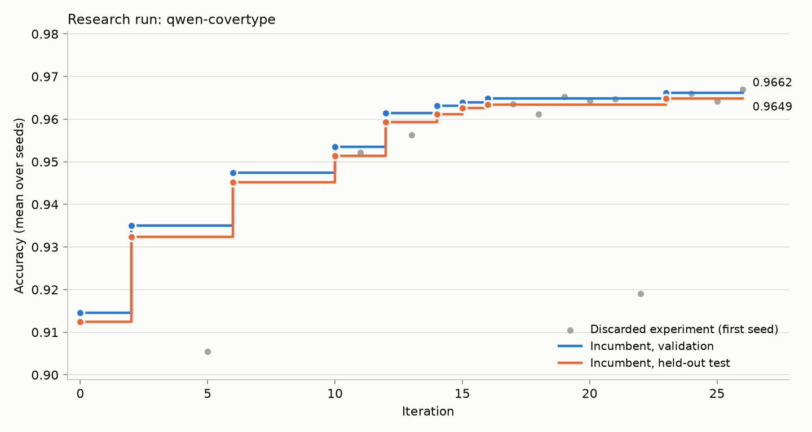

# Run report: qwen-covertype

Stopped: reached max_iters=26

## Headline

| | Validation accuracy | Test accuracy (hidden during the run) |
|---|---|---|
| Seed solution | 0.9145 ± 0.0048 | 0.9125 ± 0.0056 |
| Final incumbent (iteration 23) | 0.9662 ± 0.0001 | 0.9649 ± 0.0001 |
| Gain | +0.0517 | +0.0524 |

Mean ± standard deviation over seeds. The researcher model only ever saw the validation column; the test column measures how much of the gain is real.

## Reference models (same splits, same runner)

| Model | Validation | Test | Fit time |
|---|---|---|---|
| lightgbm_ref | 0.9709 ± 0.0004 | 0.9702 ± 0.0002 | 62s |
| logreg | 0.7269 ± 0.0000 | 0.7227 ± 0.0000 | 41s |
| seed_mlp | 0.9081 ± 0.0010 | 0.9060 ± 0.0014 | 60s |

## Activity

- Experiments: 20 (8 accepted, 10 discarded on the first seed, 2 discarded as within seed noise, 0 failed to run)
- Crashes repaired by the model and then scored: 1
- Data probes: 0
- Model tokens in the final session: 76,862 in, 42,677 out

## Accepted steps

| Iter | Kind | Validation | Test | Hypothesis |
|---|---|---|---|---|
| 0 | baseline | 0.9145 | 0.9125 | Starting point supplied with the harness. |
| 2 | architecture | 0.9350 | 0.9324 | Replacing the 3-layer MLP with a histogram-based gradient boosting classifier (sklearn HistGradientBoostingClassifier, iteration count adapted to the 60 s budget) will lift validation accuracy from 0.9145 to roughly 0.94–0.95, because GBDTs model the elevation thresholds and soil-type indicators that dominate this dataset far better than a small MLP. |
| 6 | hparam | 0.9474 | 0.9452 | Increasing max_leaf_nodes from 31 to 63 will raise validation accuracy above 0.935, because iteration 5 showed the model is capacity-limited (halving leaves dropped accuracy 3 points), so doubling leaves per tree should let each boosting round capture more complex elevation×soil boundaries even with fewer total iterations within the 60 s budget. |
| 10 | hparam | 0.9535 | 0.9513 | Increasing max_leaf_nodes from 63 to 127 will further raise validation accuracy, because the 31→63 jump gained ~1.2% and the model remains capacity-limited (train-subset holdout 0.973 vs val 0.947 gap suggests the model can fit more structure). |
| 12 | hparam | 0.9614 | 0.9593 | Increasing max_leaf_nodes from 127 to 255 will raise validation accuracy above 0.95347, because the 31→63→127 trend has been consistently positive and the model remains capacity-limited (train-subset holdout 0.984 vs val 0.953 gap shows room for more structure). |
| 14 | hparam | 0.9632 | 0.9612 | Increasing max_leaf_nodes from 255 to 511 will raise validation accuracy above 0.96139, because the 31→63→127→255 trend has been consistently positive and the model remains capacity-limited per iteration. |
| 15 | hparam | 0.9640 | 0.9625 | Increasing max_leaf_nodes from 511 to 1023 will raise validation accuracy above 0.96317, because the 31→63→127→255→511 trend has been consistently positive and the train-subset holdout (0.994) vs validation (0.963) gap of ~3% suggests the model is still capacity-limited. |
| 16 | hparam | 0.9649 | 0.9634 | Increasing max_leaf_nodes from 1023 to 2047 will raise validation accuracy above 0.96397, because the 31→63→127→255→511→1023 trend has been consistently positive and the 3.2% train/val gap still suggests the model is capacity-limited per tree. |
| 23 | regularization | 0.9662 | 0.9649 | Increasing min_samples_leaf from 20 to 50 will reduce the 3% train/val overfitting gap and raise validation accuracy, because the model is overfitting (0.994 train-subset vs 0.965 val) and the failed attempt to reduce min_samples_leaf to 5 (iter 17) confirms that less regularization hurts, implying more regularization should help. |

## Every experiment

| Iter | Kind | Outcome | Val (first seed) | Repairs | Hypothesis |
|---|---|---|---|---|---|
| 2 | architecture | accepted | 0.9334 | 2 | Replacing the 3-layer MLP with a histogram-based gradient boosting classifier (sklearn HistGradientBoostingClassifier, iteration count adapted to the 60 s budget) will lift validation accuracy from 0.9145 to roughly 0.94–0.95, because GBDTs model the elevation thresholds and soil-type indicators that dominate this dataset far better than a small MLP. |
| 5 | hparam | rejected_screen | 0.9055 | 0 | Reducing max_leaf_nodes from 31 to 15 will roughly halve per-iteration cost, allowing ~2× more boosting iterations within the 60 s budget, and because covertype's decision boundaries are dominated by simple axis-aligned thresholds (elevation, soil type), more shallow iterations should beat fewer deep ones and lift validation accuracy above 0.935. |
| 6 | hparam | accepted | 0.9466 | 0 | Increasing max_leaf_nodes from 31 to 63 will raise validation accuracy above 0.935, because iteration 5 showed the model is capacity-limited (halving leaves dropped accuracy 3 points), so doubling leaves per tree should let each boosting round capture more complex elevation×soil boundaries even with fewer total iterations within the 60 s budget. |
| 10 | hparam | accepted | 0.9529 | 0 | Increasing max_leaf_nodes from 63 to 127 will further raise validation accuracy, because the 31→63 jump gained ~1.2% and the model remains capacity-limited (train-subset holdout 0.973 vs val 0.947 gap suggests the model can fit more structure). |
| 11 | regularization | rejected_screen | 0.9522 | 0 | Reducing l2_regularization from 1.0 to 0.1 will raise validation accuracy by allowing the model to fit more complex soil-type × elevation interactions that the L2 penalty was suppressing, without significantly increasing overfitting given the modest 2.7% train/val gap. |
| 12 | hparam | accepted | 0.9611 | 0 | Increasing max_leaf_nodes from 127 to 255 will raise validation accuracy above 0.95347, because the 31→63→127 trend has been consistently positive and the model remains capacity-limited (train-subset holdout 0.984 vs val 0.953 gap shows room for more structure). |
| 13 | hparam | rejected_screen | 0.9562 | 0 | Increasing learning_rate from 0.3 to 0.5 will raise validation accuracy because with only ~74 boosting iterations the model is under-converged, and a higher step size makes each iteration more effective at reducing residual error. |
| 14 | hparam | accepted | 0.9636 | 0 | Increasing max_leaf_nodes from 255 to 511 will raise validation accuracy above 0.96139, because the 31→63→127→255 trend has been consistently positive and the model remains capacity-limited per iteration. |
| 15 | hparam | accepted | 0.9645 | 0 | Increasing max_leaf_nodes from 511 to 1023 will raise validation accuracy above 0.96317, because the 31→63→127→255→511 trend has been consistently positive and the train-subset holdout (0.994) vs validation (0.963) gap of ~3% suggests the model is still capacity-limited. |
| 16 | hparam | accepted | 0.9657 | 0 | Increasing max_leaf_nodes from 1023 to 2047 will raise validation accuracy above 0.96397, because the 31→63→127→255→511→1023 trend has been consistently positive and the 3.2% train/val gap still suggests the model is capacity-limited per tree. |
| 17 | hparam | rejected_screen | 0.9636 | 0 | Reducing min_samples_leaf from 20 to 5 will raise validation accuracy by allowing the trees to make finer-grained splits that better capture class boundaries, especially for the rare classes (3, 4, 5, 6), without causing overfitting since the average leaf size (~198 samples) far exceeds the new minimum. |
| 18 | architecture | rejected_screen | 0.9611 | 0 | Ensembling two HistGradientBoosting models (1023 leaves each, ~25 iterations each) with averaged predicted probabilities will beat the single 2047-leaf model by reducing variance, since the train/val gap of ~3% indicates overfitting that an ensemble can mitigate while maintaining similar total capacity. |
| 19 | hparam | rejected_confirm | 0.9653 | 0 | Increasing max_leaf_nodes from 2047 to 4095 will raise validation accuracy above 0.96490, because the 31→63→127→255→511→1023→2047 trend has been consistently positive and the model remains capacity-limited per tree. |
| 20 | hparam | rejected_screen | 0.9643 | 0 | Reducing max_bins from the default 255 to 128 will halve per-iteration cost, allowing ~30+ boosting iterations within the 60s budget, which should raise validation accuracy because the model is currently iteration-limited (only 17 iterations) and the extra iterations will compensate for the slightly coarser split resolution. |
| 21 | hparam | rejected_screen | 0.9648 | 0 | Reducing max_leaf_nodes from 2047 to 1023 (halving per-iteration cost) while lowering learning_rate from 0.3 to 0.2 will allow ~45 boosting iterations (vs ~17), giving substantially more effective learning (45×0.2=9.0 vs 17×0.3=5.1) and better convergence, lifting validation accuracy above 0.965. |
| 22 | architecture | rejected_screen | 0.9190 | 0 | Replacing the GBDT with a regularized MLP trained on GPU will beat 0.96490 because the neural net can learn smooth continuous interactions (elevation × soil type) more efficiently than axis-aligned tree splits, especially for the rare classes where the GBDT's discrete splits may be suboptimal. |
| 23 | regularization | accepted | 0.9661 | 0 | Increasing min_samples_leaf from 20 to 50 will reduce the 3% train/val overfitting gap and raise validation accuracy, because the model is overfitting (0.994 train-subset vs 0.965 val) and the failed attempt to reduce min_samples_leaf to 5 (iter 17) confirms that less regularization hurts, implying more regularization should help. |
| 24 | regularization | rejected_screen | 0.9660 | 0 | Increasing min_samples_leaf from 50 to 100 will further reduce the 3% train/val overfitting gap and raise validation accuracy, because the trend from 5→20→50 has been consistently positive for regularization strength and the train-subset holdout (0.997) vs validation (0.966) gap still indicates overfitting. |
| 25 | regularization | rejected_screen | 0.9641 | 0 | Adding max_features=0.5 (random feature subsampling per split) will reduce the 3% train/val overfitting gap and raise validation accuracy, because it introduces a different regularization mechanism (feature diversity) that is orthogonal to min_samples_leaf and l2_regularization, forcing the model to find robust splits across different feature subsets. |
| 26 | regularization | rejected_confirm | 0.9670 | 0 | Increasing l2_regularization from 1.0 to 3.0 will reduce the 3% train/val overfitting gap and raise validation accuracy above 0.96619, because L2 penalty directly shrinks leaf-value magnitudes (a different mechanism than min_samples_leaf) and the model's overfitting (0.997 train-subset vs 0.966 val) suggests it is making overly confident predictions in small regions. |
